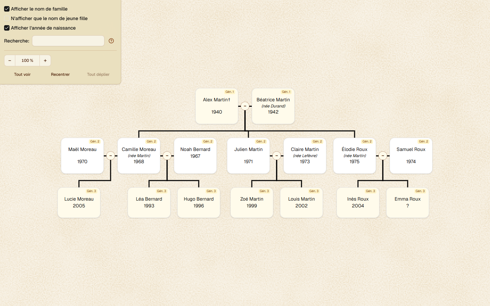
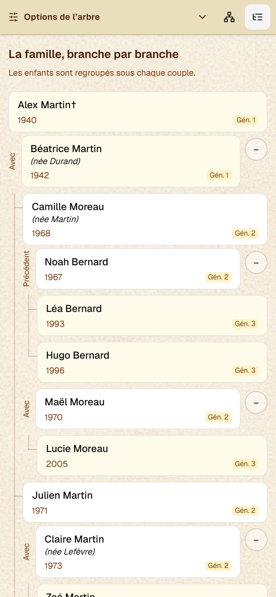

<p align="center">
  
</p>

# Family Tree

Create a family tree, explore its branches, and share it with your family.
Each installation has its own family, a password for visitors, and a separate
owner password for editing. The interface is currently in French.

- Add people and relationships at your own pace, including incomplete dates.
- Search names, open person details, and collapse branches.
- Explore the diagram on a computer or use the compact view on a phone.
- Import and download your family as JSON, and recover recent saved versions.

## A look inside

These screenshots use the fictional family in [examples/family.json](examples/family.json).

**Desktop diagram**



**Compact mobile view**



## Create your own tree

The [step-by-step setup guide](docs/setup.md) starts from a computer with no
development tools installed. Here is the route from download to a shared website:

1. **Prepare your computer and accounts.** Install [Git](https://git-scm.com/downloads)
   and [Node.js 22](https://nodejs.org/en/download) (which includes npm).
   Create [GitHub](https://github.com/signup) and [Vercel](https://vercel.com/signup)
   accounts for hosting.
2. **Make your own copy.** Fork this repository on GitHub, then clone your fork
   onto your computer. The guide explains both steps and where to type commands.
3. **Run setup.** Inside the downloaded project folder, run the commands below,
   one at a time. Setup helps you start an empty family or import a JSON file,
   and choose your viewing and owner passwords.

   ```sh
   npm ci
   npm run setup
   npm run dev
   ```

4. **Try it locally.** Open <http://localhost:3000/edit>, enter the owner password,
   add people and unions, choose a starting person, and select **Enregistrer**.
   Open <http://localhost:3000> to view the saved tree. To try the fictional
   example first, choose JSON import during setup and enter `examples/family.json`.
5. **Put it online.** Follow the guide to import your GitHub fork into Vercel,
   connect Upstash Redis, copy the required private settings from the generated
   `.env` file, and deploy again. An initial deployment can fail while these
   settings are still missing; the guide explains how to finish and retry.
6. **Share your website.** Open its `/edit` page to enter or import your family,
   save it, then share the website address and viewing password with relatives.
   Keep the owner password to yourself.

Once the website is hosted, you can edit it from your browser and turn off the
local server. Family edits appear after saving; they do not require redeployment.
Local and hosted families are separate: use a full-document JSON download and
import to transfer data between them.

Keep `.env`, family exports and backups private. GitHub stores the application
code; your family's records do not belong in the repository. Download backups
regularly from the editor.

## Help and documentation

- [First installation and hosting](docs/setup.md)
- [Exploring and searching the tree](docs/usage.md)
- [Entering data, importing, exporting and recovering revisions](docs/family-editor.md)
- [Changing or recovering passwords](docs/passwords.md)
- [Development and contributions](CONTRIBUTING.md)
- [Technical architecture](docs/architecture.md)

## License

Copyright (C) 2026 henridb.

Family Tree is free software under the GNU General Public License, version 3 only
(`GPL-3.0-only`), without warranty. See [LICENSE](LICENSE) and
[third-party notices](THIRD_PARTY_NOTICES.md).
